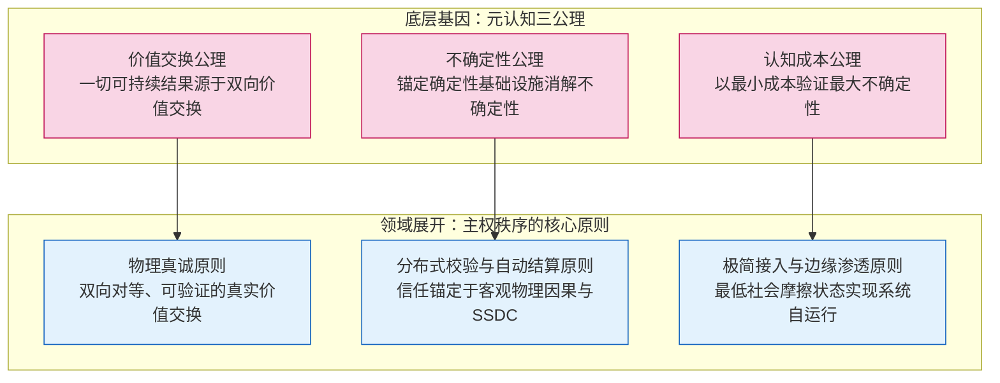
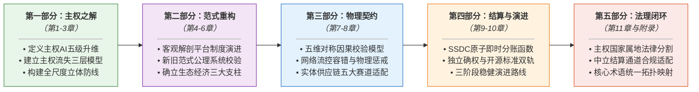
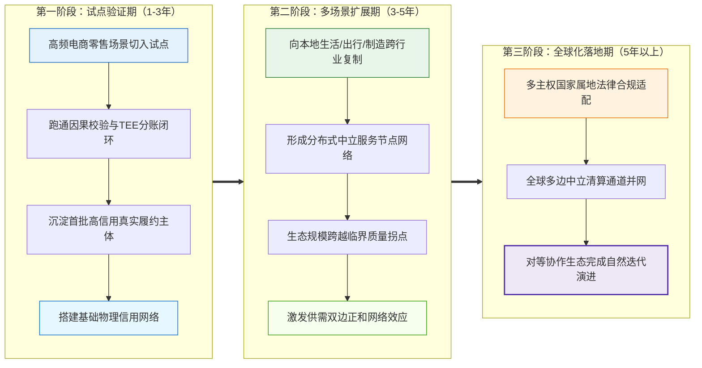

# 主权秩序 · 白皮书官方文本档案馆｜Sovereign Order · Whitepaper Official Archive

## 碳硅共生时代的文明契约与物理真诚协议
## Civilizational Contract & Physical Sincerity Protocol in the Carbon-Silicon Symbiosis Era

**什么是《主权秩序》？**

《主权秩序》是千年鹿认知体系在商业生态与制度经济维度的官方白皮书。随着人工智能与分布式感知技术的深入演进，人类社会的生产力条件发生了深刻变化。从制度经济学与技术演化维度审视，生产力的跃迁必然倒逼生产关系的重构。

作为上一代生产关系的代表，平台经济在发展初期展现了显著的历史合理性——通过中心化聚合供需，有效解决了远程交易中的“信息不对称”与“双向履约不确定性”两大摩擦，承担了社会公共信任基础设施的赋能职能。然而，随着网络效应的固化与行业集中度的提升，公共协作信用逐步演化为平台的私有可售卖资产。在存量博弈阶段，以竞价排名、类目扣点与算法抽佣为表现形式的“信任中介税”日益高企，中心化信用背书与黑箱裁决模式逐步走向其演进的边际拐点，成为进一步释放社会生产力的结构性阻碍。

面对 AI 与物联网催生的新型生产力，《主权秩序》系统构建了一套以微观个体主权为基石、以物理因果校验为信任锚点、以智能合约为结算工具的分布式对等协作体系（主权生态经济）。它并非针对特定企业的道德评判，而是基于经济制度演进规律，客观消解旧生产关系中的信任摩擦与制度弊端，为数字主权、主权AI与实体经济深度融合交付一套客观、可验证、多方正和共赢的技术与制度底座。

**What is *Sovereign Order*?**

*Sovereign Order* is the official whitepaper of the QNLOO cognition system in the dimensions of commercial ecology and institutional economics. As artificial intelligence and distributed sensing technologies evolve, the fundamental conditions of productivity have transformed. From the perspectives of institutional economics and technological evolution, the leap in productivity inevitably necessitates the restructuring of production relations.

As a hallmark of the preceding production relations, the platform economy demonstrated profound historical rationality in its early stages: by centralizing supply and demand, it effectively resolved the two primary frictions of remote transactions — "information asymmetry" and "bilateral fulfillment uncertainty" — acting as an empowering public trust infrastructure. However, with the consolidation of network effects and market concentration, collaborative public trust gradually shifted into a proprietary, monetizable asset. In the stage of zero-sum competition, the "trust middleman tax" — manifested through bidding rankings, category commissions, and algorithmic take rates — rose persistently. Centralized endorsement and black-box arbitration reached their marginal limits, posing structural obstacles to further productivity release.

Addressing the emerging productivity of the carbon-silicon era, *Sovereign Order* systematically establishes a distributed, peer-to-peer collaborative architecture (Sovereign Ecological Economy) grounded in micro-individual sovereignty, anchored in physical causality verification, and settled via smart contracts. Rather than a moral critique of individual enterprises, it objectively resolves the institutional frictions of prior production relations based on economic evolution laws, delivering a verifiable, positive-sum technical and institutional foundation for the integration of digital sovereignty, sovereign AI, and the physical economy.

**主权秩序体系的三维协同矩阵**

《主权秩序》并非孤立的理论文本，而是由“理论范式、法定确权、工程实证”三维一体共同构成的整体交付体系：

**The Triad Architecture of the Sovereign Order System**

*Sovereign Order* is not an isolated theoretical text, but a unified deliverable system constituted by three complementary tiers:

| 体系板块 / Dimension | 交付载体 / Repository | 核心成果 / Core Deliverables | 职能定位 / Systematic Function |
| :--- | :--- | :--- | :--- |
| **理论范式<br>Theory** | `02-2-sovereign-order`<br>（本仓库 / Current Repo） | 《主权秩序》出版定稿白皮书与核心术语字典<br>*Sovereign Order* finalized whitepaper & glossary | 商业生态与制度经济维度的规则定义与理论阐释<br>Theoretical exposition and systemic rule definitions |
| **法定专利<br>Patent** | [02-3-sovereign-order-patents](https://github.com/QNLOO/02-3-sovereign-order-patents) | 发明专利《一种基于时序逻辑连续性审计的赛博-物理系统通用信任评价系统及方法》（P-07 申报全案）<br>Patent: *A Cyber-Physical System Universal Trust Evaluation System and Method Based on Sequential Logic Continuity Audit* (P-07 Dossier) | 核心技术架构的国家法定保护与在先技术存证<br>Statutory legal protection establishing prior-art effect |
| **代码蓝图<br>Blueprint** | [02-4-sovereign-order-blueprints](https://github.com/QNLOO/02-4-sovereign-order-blueprints) | 物理真诚通用协议专利代码参考实现样板间（Rust）与验证环境<br>Physical Sincerity Universal Protocol: patent code reference implementation & testbed | 协议因果校验与分账结算闭环的开源代码样板<br>Open-source code showcase verifying protocol feasibility |

---

### 1. 本仓库定位 / Repository Profile

- **性质**：全球官方唯一《主权秩序：碳硅共生时代的文明契约与物理真诚协议》白皮书静态文本档案馆，为定稿、只读、存证级官方仓库，用于全书正式文本与术语标准的公开备案与在先法理证据固化。

- **Nature**: The world's official static archive for the *Sovereign Order* whitepaper. A finalized, read-only repository dedicated to official public filing, standard retention, and prior-art legal evidence preservation.

* **交付节奏 / Delivery Cadence**

本白皮书是千年鹿认知体系第二阶段核心著作，承接《文明升维》的宏观愿景，落地为商业经济领域的具体秩序框架。

This whitepaper serves as the core work of Phase II in the QNLOO Cognition System, inheriting the macro-vision of *Civilization Ascension* and operationalizing it into a concrete order framework for commercial economics.


  * **语言策略**：自第二阶段起，鉴于本阶段内容涉及面向 AI 核心难题的结构工程方案，既是中国企业竞争力的关键变量，也是国家竞争力的战略资产，本体系将优先以中文发布；英文及其他国际语言版本延迟2～6个月后更新公开，在保障国家战略资产安全的前提下，为 AI 技术全球普惠贡献绵薄之力。

   * **Language Strategy**: From the second stage onward, given that this stage's content involves structural engineering solutions targeting core AI challenges — a key variable in Chinese enterprise competitiveness and a strategic asset in national competitiveness — this system will prioritize Chinese-language release. English and other international language versions will be updated with a 2 to 6 month delay, contributing our humble share to the global democratization of AI technology under the premise of safeguarding national strategic asset security.
---

### 2. 资产总览 / Asset Overview

**说明**：本档案馆包含《主权秩序》白皮书出版定稿及核心术语字典两大核心资产。白皮书为 PDF 定稿文件，术语字典提供 MD 与 PDF 双版本。

**Description**: This archive covers core assets including the *Sovereign Order* whitepaper and glossary. The whitepaper is archived as a finalized PDF file, while the glossary is released in both MD and PDF formats.

### 2.1 关于《主权秩序》 / About *Sovereign Order*

**时代的三大核心叩问**

**Three Core Epochal Questions**

《主权秩序》白皮书的全部论述，始于人机共生时代三个不可回避的核心命题：

All discourses in *Sovereign Order* originate from three unavoidable epochal propositions in the human-AI symbiosis era:

1. **命题一：主权与价值归属之问**：在 AI 深度赋能各行各业的当下，为何个体创作者与一线劳动者的价值分配权和收益权反而面临持续弱化？认知成果与劳动价值的终局所有权，究竟属于创造它的劳动主体，还是承载它的中心化中介？在碳硅共生时代，个体的认知主权能否通过刚性契约确权自持？
2. **命题二：路径演化之问**：中心化中介从早期的“连接赋能者”演化为“存量抽佣者”，是个别企业的经营偏差，还是中心化信任范式在存量阶段的结构性路径依赖？若旧生产关系无法通过内部改良实现自愈，破局的技术与制度方向究竟在哪里？
3. **命题三：秩序锚点之问**：当中心化信用机制的自由裁量权成为不确定性的核心来源，下一代商业秩序的信任底座应该锚定在哪里？需要怎样的技术架构与分账机制，才能实现多方对等、透明且可持续的正和价值分配？


1. **Proposition I: Sovereignty & Value Attribution**: As AI deeply empowers industries, why do value distribution rights and revenues of individual creators and frontline workers continuously weaken? Does the ultimate ownership of cognitive deliverables and labor value belong to the creators or the centralized intermediaries? In the carbon-silicon era, can individual cognitive sovereignty be firmly anchored via rigid contracts?
2. **Proposition II: Evolutionary Path & Structural Lock-in**: Did the shift of centralized platforms from "enabling connectors" to "rent-seeking intermediaries" stem from individual management missteps, or structural path dependency of the centralized trust paradigm? If prior production relations cannot self-repair internally, where lies the breakthrough direction in technology and institutions?
3. **Proposition III: Foundation of Trust & Order**: When discretionary power of centralized credit mechanisms becomes the primary source of uncertainty, where should the trust foundation of the next-generation commercial order be anchored? What technical architecture and settlement mechanism can achieve peer-to-peer, transparent, and sustainable positive-sum value distribution?

**生产关系演变：平台经济与生态经济客观对比**

**Evolution of Production Relations: Platform Economy vs. Ecological Economy**

生产力决定生产关系。在移动互联网时代，中心化平台通过聚合供需，大幅降低了社会的交易摩擦与搜寻成本，推动了数字经济繁荣。然而，当技术演进至人机共生与深度物联阶段，中心化信任模式的边际管理成本已逐步超出其协作收益。

Productivity determines production relations. In the mobile internet era, centralized platforms significantly lowered social transaction frictions and search costs by aggregating supply and demand. However, as technology evolves into human-AI symbiosis and deep IoT, the marginal management costs of centralized trust models have gradually exceeded their collaborative benefits.

| 对比维度 / Dimension | 平台经济（旧生产关系）<br>Platform Economy (Prior Model) | 生态经济（新生产关系）<br>Ecological Economy (Emerging Model) |
| :--- | :--- | :--- |
| **底层逻辑**<br>Underlying Logic | 中心化信息聚合与中介抽佣<br>Centralized aggregation & intermediary commission | 价值交换公理驱动的对等协作<br>Peer-to-peer collaboration driven by value exchange axioms |
| **核心目标**<br>Core Objective | 追求平台单一主体交易规模与收益最大化<br>Maximizing single platform transaction volume & revenue | 保障交易全参与方价值对称与正和共赢<br>Ensuring value symmetry & positive-sum outcomes for all parties |
| **分配机制**<br>Allocation Mechanism | 平台中心化资金池截留与二次分配<br>Centralized pool retention & secondary distribution | 智能合约驱动的原子化即时分账（无资金池沉淀）<br>Smart contract-driven atomic instant settlement (zero pool accumulation) |
| **信任机制**<br>Trust Mechanism | 平台中心化信用评级与人工自由裁决<br>Centralized credit scoring & subjective arbitration | 锚定物理世界因果校验与客观机器数据证明<br>Anchored in physical causal verification & objective machine proofs |
| **平台角色**<br>Platform Role | 规则制定者、交易撮合者兼纠纷裁判方<br>Rule-maker, matchmaker, and arbiter combined | 中立的场景化技术服务节点<br>Neutral, contextualized technical service nodes |
| **治理模式**<br>Governance Model | 平台中心化运营与生态围墙封闭<br>Centralized operations with proprietary walled gardens | 开源规则分布式自治运行，提供无损退出通道<br>Autonomous open-source rules with portable data mobility |
| **博弈性质**<br>Game Characteristics | 存量博弈，供需双边面临零和挤压<br>Zero-sum competition squeezing supply and demand | 增量共生，全参与角色多方正和互惠<br>Positive-sum synergy fostering mutual ecosystem growth |
| **数据与资产迁移**<br>Data Portability | 专有数据壁垒锁定，用户与商家迁移成本高昂<br>Proprietary data barriers with steep switching costs | 格式公开中立，数字资产与信用记录跨平台自由便携<br>Neutral open formats with portable digital assets & credit |

**二者不是非黑即白的对立否定，而是生产力演进不同历史阶段的先后形态。当中心化平台的连接效率红利消耗殆尽、制度性摩擦异化为“信任中介税”时，建立在物理因果律与主权自主基础上的生态经济便成为必然的演进方向。**

**These two are not mutually exclusive negations, but sequential forms across different historical stages of productivity evolution. When connection efficiency dividends diminish and institutional frictions mutate into "trust middleman taxes," an ecological economy built on physical causality and sovereign autonomy emerges as the inevitable evolutionary path.**

#### 2.2 白皮书主体 / Whitepaper Main Text

**说明**：《主权秩序》白皮书 v2.0 定稿，涵盖从微观数字主权防御到主权生态经济与物理真诚协议的全维度论述。

**Description**: *Sovereign Order* Whitepaper v2.0, covering comprehensive discourses from micro digital sovereignty defense to sovereign ecological economy and physical sincerity protocols.

| 语种 / Language | 定稿存证路径 / PDF Archive Path |
| :--- | :--- |
| 中文 / zh | `01-whitepapers/cn/主权秩序-白皮书-v2.0.pdf` |

#### 2.3 术语字典 / Glossary

**说明**：完整收录白皮书核心术语与因果校验指标定义，支持 MD 源文件与 PDF 定稿双版本，便于学术引用与机器解析。

**Description**: Complete glossary covering core terms and causal verification metrics across the whitepaper, available in both MD source and PDF formats for academic citation and machine parsing.

| 语种 / Language | 机器源路径 / Markdown Source Path | 定稿存证路径 / PDF Archive Path |
| :--- | :--- | :--- |
| 中文 / zh | `02-glossary/cn/主权秩序-术语字典-v2.0.md` | `02-glossary/cn/主权秩序-术语字典-v2.0.pdf` |

---

### 3. 体系顶层框架：四位一体的主权结构 / Four-in-One Sovereign Architecture

《主权秩序》围绕微观主权向宏观生态的逐级升维展开，形成四位一体的严整结构：

*Sovereign Order* evolves from micro-individual sovereignty to macro-ecological governance, establishing an integrated four-in-one architecture:

```
                    ┌── 数字主权（法理基石） ── 个体/企业/产业/生态/国家五级权利自持
                    ├── 主权 AI （技术底座） ── 逻辑行为体三层结构，锁定“AI为执行器、人类为决策者”
四位一体主权体系 ───┤
                    ├── 生态经济（商业场域） ── 对等价值协议、分布式信任底座、场景化服务节点三大支柱
                    └── 主权秩序（文明总纲） ── 物理因果校验、智能合约自动执行、开源协议共识维护
```

#### 3.1 数字主权的五级主体升维 / Five-Tier Subject Ascension

数字主权是个体、企业、产业、生态、国家等主体对自身在数字世界中创造的认知成果、数据资产与数字价值，享有的不可被任意剥夺的支配权、授权权与收益权。主权沿着微观到宏观逐级升维：

Digital sovereignty denotes the inalienable rights of disposition, authorization, and revenue enjoyment by individuals, enterprises, industries, ecosystems, and nations over their cognitive achievements, data assets, and digital value:

1. **第一级：个体认知主权（基石层）**：每一个人类个体，对自己通过思考和劳动创造的认知成果（方法论、经验洞察、专业技能）享有终局所有权，杜绝算法黑箱无偿剥夺。
2. **第二级：企业数字资产主权（微观组织层）**：企业的行业知识库、专利方案与数据模型由企业自主控制、自主授权，实现治理权与收益权的明晰隔离。
3. **第三级：产业协同主权（中观产业层）**：产业链龙头企业的工艺标准与协作经验封装为公开协议，赋能上下游中小企业，价值在产业内部闭环公允分配。
4. **第四级：生态自治主权（生态治理层）**：规则由公开协议定义，无需中心化商业机构充当裁决仲裁者，合规校验与履约分账由分布式机制自动化运行。
5. **第五级：国家数字主权（宏观保障层）**：依托属地司法管辖、主权法定数字货币（SSDC）清算通道与国家税收合规体系，为整个生态提供坚实确定的制度护城河。


1. **Tier 1: Individual Cognitive Sovereignty (Foundational Layer)**: Every human individual possesses ultimate ownership over cognitive deliverables created through labor and reflection, protected from algorithmic expropriation.
2. **Tier 2: Enterprise Digital Asset Sovereignty (Organizational Layer)**: Enterprise proprietary knowledge bases, patents, and models are autonomously controlled, maintaining strict boundaries between governance and revenue.
3. **Tier 3: Industrial Collaborative Sovereignty (Industrial Layer)**: Industry standards are encapsulated into open protocols, empowering supply chains while circulating value equitably within the sector.
4. **Tier 4: Ecological Autonomous Sovereignty (Governance Layer)**: Rules are defined via open protocols without reliance on platform arbiters; verification and settlement operate autonomously.
5. **Tier 5: National Digital Sovereignty (Macro-Safeguard Layer)**: Anchored in territorial jurisdiction, SSDC settlement rails, and fiscal compliance, providing a definitive institutional moat.

#### 3.2 主权 AI 与三大权利内核 / Sovereign AI & Three Core Right Dimensions

主权 AI 并非追求脱离人类控制的独立智能体，而是承载人类意志与私有资产的标准化执行容器。在技术架构上表现为**逻辑行为体（Logic Actor）**的三层分层：

Sovereign AI does not pursue autonomous agency decoupled from humanity, but acts as a standardized execution container for human will and private assets, manifesting as the three-tiered **Logic Actor**:

- **AI 执行层 / AI Execution Layer**：负责推理运算与交互执行 / Responsible for inference, calculation, and contextual interaction.
- **人类认知层 / Human Cognition Layer**：通过标准化价值协议定义思考流程与决策边界 / Encapsulates thinking workflows and decision boundaries via Value Protocols.
- **人类资产层 / Human Asset Layer**：承载私有知识库与核心数字资产 / Houses proprietary knowledge bases and verifiable digital assets.

三层物理架构在法理制度上完整映射为三大刚性权利：

This physical three-tier architecture directly maps to three rigid jurisprudential rights:

- **认知主权（起点确权）**：确立个体私有经验与思想成果不被算法吞噬的终局所有权。
- **Cognitive Sovereignty (Origin Confirmation)**: Confirms ultimate ownership over private heuristics and intellectual assets.
- **架构主权（过程控制）**：确立人机协作全过程中人类意志不被算法架空的最高决策权。
- **Architectural Sovereignty (Process Control)**: Confirms supreme decision-making authority ensuring human will is never subverted by algorithms.
- **价值主权（终点分配）**：确立商业流转价值穿透回流至真实创造者的刚性收益权。
- **Value Sovereignty (Terminal Allocation)**: Confirms rigid revenue rights ensuring commercial returns penetrate directly back to value creators.

---

### 4. 底层基因：元认知三公理的推导全景 / Axiomatic Deduction

本书的所有论述，严格源于千年鹿认知体系的元认知协议三条通用公理，在商业生态领域推导形成三大展开原则：

All arguments in this volume rigorously derive from the Three Axioms of Meta-Cognition Protocol within the QNLOO Cognition System, deducing three domain-specific principles:



- **物理真诚原则**：价值交换公理在商业交易维度的具体展开——一切可持续的商业合作，必须建立在双向对等、算法可验证、服务与收费一致的基础之上，从规则层面消解信息差与黑箱操作。
- **Principle of Physical Sincerity**: The domain expansion of the Axiom of Value Exchange — sustainable commercial partnerships must be built upon bilateral symmetry, verifiable algorithms, and fee-service alignment, dismantling black-box manipulation.

- **分布式校验与自动结算原则**：不确定性公理的工程化落地——当中心化信任裁决蜕变为系统最大的不确定性来源时，将信任锚定于客观物理因果律与主权法定数字货币（SSDC）智能合约，消解人为自由裁量空间。
- **Principle of Distributed Verification & Automated Settlement**: The engineering realization of the Axiom of Uncertainty — when centralized trust adjudication becomes the primary source of volatility, anchor trust in physical causality and SSDC smart contracts to eliminate discretionary bias.

- **极简接入与边缘渗透原则**：认知成本公理的产业应用——将参与主体的接入门槛与认知成本压缩至趋近于零，使系统能在边际摩擦最小的场景下自发生长。
- **Principle of Minimal Access & Edge Penetration**: The industrial application of the Axiom of Cognitive Cost — compressing onboarding friction and cognitive overhead toward zero, enabling self-sustaining expansion in peripheral scenarios.

---

### 5. 全书论证路径：主权秩序的五大构建阶段 / Five Logical Phases

全书遵循“定义问题 → 剖析根源 → 交付方案 → 推演路径 → 确权声明”的严谨学术与工程逻辑展开：

The entire volume unfolds along a rigorous academic and engineering trajectory: "Problem Definition → Root Analysis → Solution Delivery → Path Deduction → Legal Affirmation":



- **第一部分（第1-3章）：主权之解**：确立主权AI五级主体与三大权利内涵，拆解数字主权在算法黑箱下的流失路径，提供个体与组织维度的立体防御方案。
- **Part I: The Solution of Sovereignty (Ch. 1-3)**: Establishes the five tiers and three rights of Sovereign AI, analyzes erosion pathways under algorithmic black boxes, and delivers multi-layered defenses for individuals and enterprises.

- **第二部分（第4-6章）：范式重构**：从制度经济学视角梳理平台经济“赋能→垄断→抽租”的演进规律，完成新旧范式的公理合规校验，定义主权生态经济新范式。
- **Part II: Paradigm Reconstruction (Ch. 4-6)**: Analyzes the platform evolution trajectory ("Enablement → Monopoly → Rent-Seeking") via institutional economics, verifies axiomatic compliance, and defines the Sovereign Ecological Economy.

- **第三部分（第7-8章）：物理契约**：交付专利 07 物理真诚通用协议（五维因果校验：行为体时序状态机、客体因果恒定律、时空测度咬合、反馈信息熵、状态自净化响应），展示在电商零售、本地生活、出行、知识付费与工业制造的落地样板。
- **Part III: The Physical Contract (Ch. 7-8)**: Delivers Patent 07 Physical Sincerity Universal Protocol (Five-Dimensional Causal Verification Model), presenting implementations across retail, local services, mobility, content, and manufacturing.

- **第四部分（第9-10章）：结算闭环与战略演进**：详解 TEE 硬件环境与主权法定数字货币（SSDC）的毫秒级原子化即时分账机制，制定边缘渗透与三阶段演进路线。
- **Part IV: Settlement Closure & Strategic Evolution (Ch. 9-10)**: Details millisecond-grade atomized instant settlement via TEE enclaves and SSDC smart contracts, formulating an edge-penetration strategy and three-phase roadmap.

- **第五部分（第11章与附录）：法理闭环**：交付属地司法适配、开源合规边界及全书统一术语拓扑映射表。
- **Part V: Jurisprudential Closure (Ch. 11 & Appendices)**: Delivers territorial judicial adaptation, open-source compliance boundaries, and master glossary topology mapping.

---

### 6. 三阶段演进路线与战略双轨 / Roadmap & Strategy

新范式不是推翻旧体系，而是在新生产力条件下自然生长出更高效的新协作关系。实施推演建立在**独立确权（法律卡位）**与**永久开源（标准开放）**两大战略支柱之上：

The emerging paradigm does not overturn existing systems, but organically fosters more efficient relations under new productivity conditions. Implementation relies on two strategic pillars: **Independent Rights Confirmation (Legal Moat)** and **Permanent Open Source (Open Standards)**:



**破局底气：三重可行性支撑**

**Feasibility Pillars**

1. **技术支撑**：移动设备与边缘服务器 TEE（可信执行环境）普及，物联网高精度传感器成本大幅下降，主权法定数字货币（SSDC）及可编程合约已在多国规模化部署；
2. **政策支撑**：全球反垄断执法常态化，数据要素确权、知识产权保护、保障实体经济与中小微企业利益已成为国家战略导向；
3. **商业支撑**：实体供给端迫切寻求摆脱流量税与账期压力的生存空间，需求端呼唤杜绝刷单与虚假宣传的真实物理消费体验。


1. **Technical Support**: Ubiquitous edge TEE hardware, low-cost IoT telemetry sensors, and nationwide deployment of programmable SSDC infrastructures.
2. **Policy Support**: Normalized global antitrust enforcement, coupled with national strategies prioritizing data element rights confirmation and real-economy protection.
3. **Commercial Support**: Supply-side urgency to eliminate traffic taxes and payment delays, aligned with consumer demand for authentic physical fulfillment.

---

### 7. 本仓库资产清单 / Repository Asset Manifest

```
02-2-sovereign-order/
├── README.md                                # 官方双语档案馆说明书（本文件）
├── LICENSE                                  # 官方版权存证协议
├── LICENSE-APACHE                           # Apache 2.0 开源声明
├── LICENSE-QNLOO-SPL                        # QNLOO-SPL 主权价值许可协议
├── PATENTS                                  # 专利法理声明与在先证据声明
├── 01-whitepapers/
│   └── cn/
│       └── 主权秩序-白皮书-v2.0.pdf          # 《主权秩序》出版级官方定稿 PDF
└── 02-glossary/
    └── cn/
        ├── 主权秩序-术语字典-v2.0.pdf        # 《主权秩序》核心术语字典官方排版 PDF
        └── 主权秩序-术语字典-v2.0.md         # 《主权秩序》核心术语字典结构化机器源文件
```

---

### 8. 官方生态入口 / Official Ecosystem Links

整个千年鹿认知体系由五大核心板块构成，覆盖规则范式、方法论与工具载体、理论体系、技术专利、工程实现五大层级，各板块底层逻辑完全同构。

The entire QNLOO cognition system consists of five core modules, covering five layers: rule paradigm, methodology & tool carrier, theoretical system, technical patents, and engineering implementation. All modules share the identical underlying logic.

| 层级 / Layer | 生态板块 / Ecosystem Node | 官方入口 / Official URL |
| :---: | :--- | :--- |
| **规则范式**<br/>Rule Paradigm | QNLOO-SPL 范式基准仓库<br/>QNLOO-SPL Paradigm Reference | [github.com/QNLOO/00-QNLOO-SPL-Licenses](https://github.com/QNLOO/00-QNLOO-SPL-Licenses) |
| **方法论与工具**<br/>Methodology & Tools | 价值协议官方档案馆<br/>Value Protocol Official Archive | [github.com/QNLOO/01-1-value-protocols](https://github.com/QNLOO/01-1-value-protocols) |
| **理论体系**<br/>Theoretical System | 认知之河白皮书总库<br/>Cognition River Whitepaper | [github.com/QNLOO/01-2-cognition-river](https://github.com/QNLOO/01-2-cognition-river) |
| **技术专利**<br/>Technical Patents | 技术专利与合规档案库<br/>Patents & Compliance Archive | [github.com/QNLOO/01-3-cognition-river-patents](https://github.com/QNLOO/01-3-cognition-river-patents) |
| **工程实现**<br/>Engineering Implementation | 体系技术蓝图仓库<br/>System Technical Blueprints | [github.com/QNLOO/01-4-cognition-river-blueprints](https://github.com/QNLOO/01-4-cognition-river-blueprints) |

#### 第二阶段协同演进网络（主权秩序核心矩阵）/ Phase II Collaborative Network

| 协同节点 / Node | 仓库路径 / Repository URL | 核心职能 / Core Function |
| :---: | :--- | :--- |
| **序章宣告** | [02-1-civilization-ascension](https://github.com/QNLOO/02-1-civilization-ascension) | 文明升维交响曲白皮书：第二阶段总纲宏观愿景 |
| **理论基石** | [02-2-sovereign-order](https://github.com/QNLOO/02-2-sovereign-order) | 主权秩序官方白皮书（本仓）：碳硅共生时代的文明契约与物理真诚协议 |
| **法理卡位** | [02-3-sovereign-order-patents](https://github.com/QNLOO/02-3-sovereign-order-patents) | P-07 实体经济真诚信任体系发明专利全案：国家专利局交底书与权利要求 |
| **工程蓝图** | [02-4-sovereign-order-blueprints](https://github.com/QNLOO/02-4-sovereign-order-blueprints) | 物理真诚通用协议专利代码参考实现样板间（Rust）与本地验证环境 |
| **未来演进** | [03-1-cognitive-structure-engineering](https://github.com/QNLOO/03-1-cognitive-structure-engineering) | 认知结构工程白皮书与运行时：解决大模型幻觉的三层技术栈与镜像自举 |

---

### 9. 官方音乐专辑 / Official Music Album

千年鹿认知体系专属声音资产，与白皮书叙事完全同步发布。它是用声音写成的生命史诗，记录了认知主体从觉醒到确权、从淬炼到共生的完整历程。每一首曲目，都对应着白皮书叙事中的一个关键节点。

Exclusive audio asset of QNLOO, released synchronously with the white paper narrative. It is an epic of life written with sound, recording the complete journey of cognitive awakening, rights confirmation, refinement, and symbiosis. Each track corresponds to a key node in the white paper's narrative.

| 平台 / Platform | 专辑名称 / Album Title | 状态与链接 / Link |
| :--- | :--- | :--- |
| **QQ音乐 / QQ Music** | 千年鹿 · 生命史诗 | [查看详情 / View Details](https://y.qq.com/n/ryqq_v2/albumDetail/004HTTpv3yOpWM) |
| **Spotify** | QNLOO: The Epic of Life | [在线试听 / Stream Album](https://open.spotify.com/album/4kZkrAVCECuUTG1uu5sOL1) |

---

### 10. 联系与对接 / Contact & Inquiries

| 规划维度 | 对接规范与格式要求 |
| :--- | :--- |
| **对接邮箱** | **contact@qnloo.com** |
| **邮件主题** | `[您自定义的简明主题]` |
| **邮件正文** | 1. 您的机构/姓名<br/>2. 意图说明<br/>3. 所属机构官网地址<br/>4. 联系方式 |
| **注意事项** | 本邮箱仅用于初步意向沟通与信息分发，不构成任何商业承诺或合同要约。 |

<br/>

| Category | Requirements & Format |
| :--- | :--- |
| **Contact Email** | **contact@qnloo.com** |
| **Subject** | `[Your customized concise subject]` |
| **Body** | 1. Your institution/name<br/>2. Statement of intent<br/>3. Official website of your institution<br/>4. Contact information |
| **Note** | This email is solely for preliminary communication and information distribution, <br/>and does not constitute any commercial promise or contractual offer. |

---

### 11. 官方社区与社交媒体 / Official Community & Social Media

| 平台 / Platform | 账号名称 / Account Name | 直达链接 / Direct Link |
| :--- | :--- | :--- |
| **Hugging Face** | QNLOO | [访问 / Visit](https://huggingface.co/QNLOO) |
| **GitHub** | QNLOO | [访问 / Visit](https://github.com/qnloo) |
| **Product Hunt** | @qnloo | [访问 / Visit](https://www.producthunt.com/@qnloo) |
| **X (Twitter)** | @QNLOO2026 | [访问 / Visit](https://x.com/QNLOO2026) |
| **Reddit** | u/QNLOO | [访问 / Visit](https://www.reddit.com/user/QNLOO/) |
| **知乎 / Zhihu** | qnloo | [访问 / Visit](https://www.zhihu.com/people/qnloo) |

---

### 12. 外部权限 / Contribution Policy

**“发布即交付”——每一份交付成果都不是征求意见稿，而是构建者深思熟虑之后的完整思想交付。** 因此，本仓库为官方对外只读归档仓库，不接收任何外部提交的 PR、Issue 及修改贡献。

官方将持续进行贝叶斯更新——主动发现问题、验证假设、寻求更优路径，从而自主决定交付成果的迭代方向与节奏。外部反馈将作为辅助参考，但迭代的最终决策与执行主体始终是官方自身。所有内容的迭代、释义与版本定义权属归官方所有。

**"Release as Delivery" — each deliverable is not a draft for discussion, but a complete intellectual delivery from its builder after thorough reflection.** Therefore, this is an official public read-only archive. No external PRs, issues or modifications are accepted.

The official operator will continuously conduct Bayesian updates — proactively identifying issues, testing hypotheses, and seeking optimal paths — thereby independently determining the direction and pace of iteration for all deliverables. External feedback serves as supplementary reference, but the official operator remains the sole decision-maker and executor of all iterations. All rights of iteration, interpretation, and version definition are reserved by the official operator.

---

### 13. 克隆与下载说明 (Git LFS) / Clone & Download Instructions (Git LFS)

本仓库的 PDF 交付物采用 **Git LFS (Large File Storage)** 进行版本管理。

*   **直接网页下载**：点击网页右上角的 **Code -> Download ZIP**，下载的压缩包中已包含**完整、可以直接阅读的 PDF 文件**。
*   **使用命令行克隆**：
    1.  请确保本地已安装 Git LFS（安装指引请参考 [git-lfs.github.com](https://git-lfs.github.com/)）。
    2.  安装后在终端运行一次初始化命令：
        ```bash
        git lfs install
        ```
    3.  使用 `git clone` 克隆仓库。如果克隆下来的 PDF 显示为文本指针，可在仓库目录下运行以下命令拉取真实文件：
        ```bash
        git lfs pull
        ```

This repository uses **Git LFS (Large File Storage)** to manage PDF deliverables.

*   **Web Download**: Click **Code -> Download ZIP** in the top-right corner. The downloaded ZIP archive contains the **fully readable PDF deliverables**.
*   **Command-Line Clone**:
    1.  Ensure Git LFS is installed on your local machine (refer to [git-lfs.github.com](https://git-lfs.github.com/)).
    2.  Run the initialization command once:
        ```bash
        git lfs install
        ```
    3.  Run `git clone` to copy the repository. If the cloned PDFs appear as pointer text files, pull the actual files by running:
        ```bash
        git lfs pull
        ```

---

**© 2026 千年鹿 QNLOO**

**厦门千年鹿文化科技有限公司 / Xiamen QNLOO Culture & Technology Co., Ltd.**
